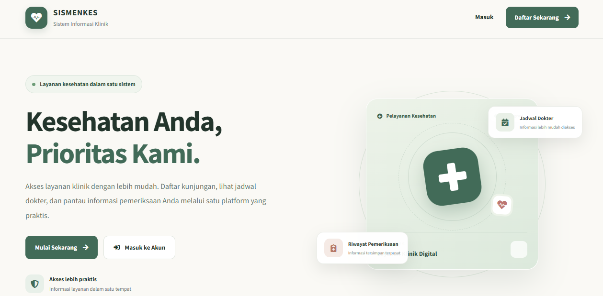
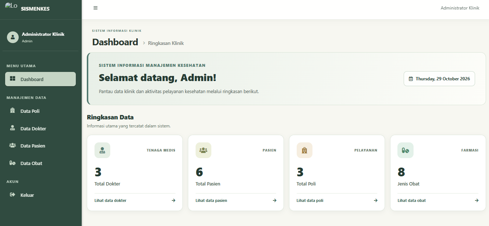
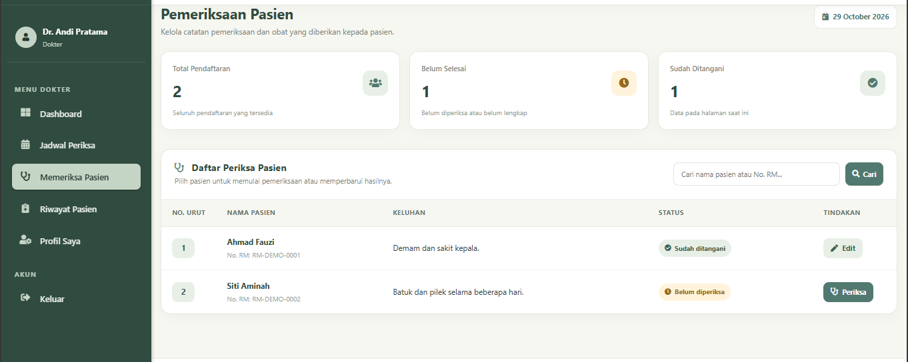

# Sistem Manajemen Kesehatan

Aplikasi manajemen kesehatan berbasis web yang dirancang untuk membantu pengelolaan informasi dan administrasi layanan kesehatan secara terintegrasi. Sistem ini menyediakan beberapa fitur untuk mendukung pengelolaan data pasien, dokter, poli, serta proses pemeriksaan melalui antarmuka yang mudah digunakan.

Proyek ini dikembangkan menggunakan Laravel sebagai implementasi pengembangan aplikasi web dan sistem informasi berbasis basis data.

## 📋 Tentang Proyek

**Sistem Manajemen Kesehatan** merupakan aplikasi yang menyediakan platform terpusat untuk mengelola aktivitas administrasi layanan kesehatan. Sistem memiliki beberapa jenis dashboard berdasarkan peran pengguna, sehingga setiap pengguna dapat mengakses informasi dan fitur sesuai dengan kebutuhannya.

Aplikasi ini berfokus pada pengelolaan data yang terstruktur, kemudahan akses informasi, dan dukungan terhadap proses administrasi layanan kesehatan.

## ✨ Fitur Utama

- **Dashboard Admin** — Menyediakan ringkasan informasi dan akses ke berbagai fitur pengelolaan sistem.
- **Dashboard Dokter** — Menyediakan halaman khusus bagi dokter untuk mengakses informasi dan aktivitas yang berkaitan dengan pemeriksaan.
- **Dashboard Pasien** — Menyediakan halaman bagi pasien untuk mengakses informasi layanan kesehatan.
- **Pengelolaan Data Pasien** — Mengelola informasi dan data pasien yang terdaftar dalam sistem.
- **Pengelolaan Data Dokter** — Mengelola informasi dokter yang tersedia dalam sistem.
- **Pengelolaan Data Poli** — Mengelola informasi poli sebagai bagian dari layanan kesehatan.
- **Pemeriksaan** — Mendukung proses pengelolaan informasi pemeriksaan pasien.

## 📸 Tampilan Aplikasi

### 1. Halaman Utama

Halaman utama merupakan tampilan awal aplikasi yang memperkenalkan layanan dan informasi Sistem Manajemen Kesehatan kepada pengguna.



### 2. Dashboard Admin

Dashboard admin menyajikan ringkasan informasi sistem dan menyediakan akses ke berbagai modul administrasi untuk mempermudah pengelolaan data.



### 3. Halaman Pemeriksaan

Halaman pemeriksaan digunakan untuk mendukung pengelolaan proses pemeriksaan pasien melalui sistem, sehingga informasi pemeriksaan dapat dikelola secara terstruktur.



## 🛠️ Teknologi yang Digunakan

| Teknologi | Kegunaan                                        |
| --------- | ----------------------------------------------- |
| PHP       | Bahasa pemrograman sisi server                  |
| Laravel   | Kerangka kerja pengembangan aplikasi web        |
| MySQL     | Sistem manajemen basis data relasional          |
| Blade     | Mesin templat untuk membangun tampilan aplikasi |
| AdminLTE  | Templat antarmuka dashboard administrasi        |

## ⚙️ Persyaratan Sistem

Sebelum menjalankan aplikasi, pastikan perangkat telah memiliki:

- PHP dengan versi yang sesuai dengan proyek.
- Composer.
- MySQL.
- Node.js dan npm.
- Git.

## 🚀 Instalasi dan Menjalankan Aplikasi

Ikuti langkah-langkah berikut untuk menjalankan aplikasi di lingkungan lokal.

### 1. Kloning repositori

```bash
git clone https://github.com/Hariss1011/Sistem-Manajemen-Kesehatan.git
cd Sistem-Manajemen-Kesehatan
```

### 2. Instal dependensi

```bash
composer install
npm install
```

### 3. Konfigurasi lingkungan aplikasi

Salin file `.env.example` menjadi `.env`.

Pada Windows, file tersebut dapat disalin secara manual melalui File Explorer.

Selanjutnya, buat application key:

```bash
php artisan key:generate
```

### 4. Konfigurasi basis data

Buat basis data MySQL terlebih dahulu, kemudian sesuaikan konfigurasi berikut di dalam file `.env`:

```env
DB_CONNECTION=mysql
DB_HOST=127.0.0.1
DB_PORT=3306
DB_DATABASE=nama_database
DB_USERNAME=root
DB_PASSWORD=
```

Sesuaikan nama basis data, username, dan password dengan konfigurasi MySQL di perangkat masing-masing.

### 5. Jalankan migrasi basis data

```bash
php artisan migrate
```

Jika proyek menyediakan seeder untuk mengisi data awal, jalankan perintah berikut setelah memastikan konfigurasi seedernya:

```bash
php artisan db:seed
```

### 6. Bangun aset frontend

```bash
npm run build
```

### 7. Jalankan aplikasi

```bash
php artisan serve
```

Akses aplikasi melalui alamat berikut:

`http://127.0.0.1:8000`

## 📂 Struktur Proyek

Aplikasi menggunakan struktur direktori standar Laravel dengan beberapa direktori utama berikut:

```text
Sistem-Manajemen-Kesehatan/
├── app/
│   ├── Http/
│   │   └── Controllers/
│   └── Models/
├── database/
│   ├── migrations/
│   └── seeders/
├── docs/
│   └── screenshots/
├── resources/
│   └── views/
├── routes/
│   └── web.php
├── README.md
└── composer.json
```

## 🎯 Tujuan Pengembangan

Melalui pengembangan proyek ini, beberapa kemampuan teknis yang diterapkan meliputi:

- Pengembangan aplikasi web menggunakan PHP dan Laravel.
- Pengelolaan basis data relasional menggunakan MySQL.
- Implementasi operasi CRUD untuk pengelolaan informasi.
- Pengorganisasian tampilan menggunakan Blade dan AdminLTE.
- Perancangan sistem informasi berdasarkan kebutuhan administrasi layanan kesehatan.
- Penerapan pengelolaan akses berdasarkan peran pengguna.

## 📌 Status Proyek

Proyek ini dikembangkan sebagai proyek akademik dan portofolio untuk menerapkan kemampuan pengembangan aplikasi web serta perancangan sistem informasi.

## 👨‍💻 Pengembang

**Akhmad Haris**

- GitHub: [Hariss1011](https://github.com/Hariss1011)

---

Dikembangkan sebagai bagian dari pembelajaran dan penerapan pengembangan aplikasi web berbasis Laravel.
